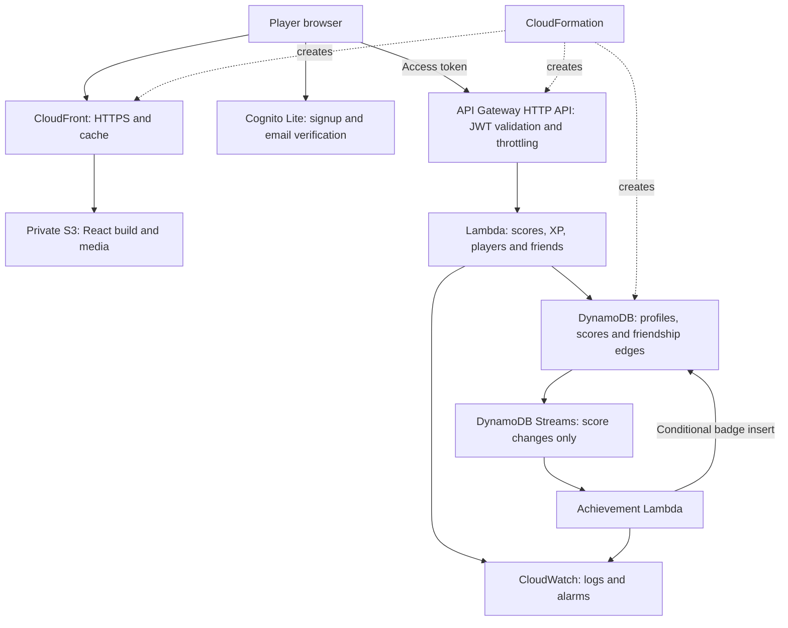

# How Arcade Hub uses AWS

## Request flow

| Component | Purpose and design decision |
|---|---|
| S3 | Private objects with public access blocked; CloudFront origin access control grants only this distribution permission to read. No website endpoint. |
| CloudFront | HTTPS, compression, cached hashed assets, and SPA route fallback. Uses the AWS-provided domain and certificate. The template uses pay-as-you-go CloudFront covered by account allowances/credits while on the Free account plan; it does not provision a separate flat-rate subscription. |
| Cognito Lite | Password handling belongs to a managed identity service. No client secret in React. Email verification uses Cognito's default email service; no SMS or custom SES setup. |
| HTTP API | Validates JWT signature, issuer, audience and the access-token scope. Throttling starts at 2 requests/second with a burst of 5 to suit a class demo. |
| API Lambda | Derives player ID from the verified token. Validates game, score range and UUID; transactions update scores and XP together. |
| DynamoDB | Provisioned capacity: 5 reads/5 writes for the table and 1/1 for each of two indexes (7/7 total). No autoscaling, paid backup features, global tables, or scans in the application. |
| Streams + achievement Lambda | Score changes asynchronously award first-score and per-game 100-point badges. Conditional writes make retries safe. Stream filters prevent badge writes from triggering themselves. |
| IAM | Separate runtime roles; API functions can access only the app table/indexes and their logs. The achievement worker can read its stream and put badge records. |
| CloudWatch | Three-day log retention, no request-body/token logging, and two standard alarms for API 5xx and achievement Lambda errors. No email notification subscriptions or paid dashboards. |
| CloudFormation | Creates the same environment from source, exposes deployment outputs, and produces reviewable change sets. No SAM installation is needed. |

## Data model and access patterns

All data uses one table with `pk` and `sk` keys.

| Item | Partition key | Sort key | Access |
|---|---|---|---|
| Player profile | USER#subject | PROFILE | Exact lookup for signed-in player |
| Game cumulative score | USER#subject | SCORE#game | Query one player's scores |
| Friend edge | USER#subject | FRIEND#friendSubject | Query followed friends; one-way relationship |
| Badge | USER#subject | BADGE#badgeId | Query earned achievements |
| Submission receipt | USER#subject | REQUEST#UUID | Atomic replay protection; TTL cleanup after seven days |

`Directory` index: `directoryPk=PLAYERS`, `directorySk=username`. Supports exact username lookup and prefix search without scanning all players.

`Leaderboard` index: `rankPk=PLAYERS`, numeric `xp`. Queries the top 50 players in descending XP order. This is an all-time leaderboard, not weekly or per-game ranking. Index reads are eventually consistent; a new player/score may take a moment to appear. These shared index partitions suit a small classroom workload; a large public game would need a different ranking design.

Private profile/score/badge reads are allowed for the player or a player who has added them as a friend. Leaderboards and username search expose only username, player ID and XP, never email.

Score submissions are deltas. Most original games report scoring events; Tetris submits its total at game over, and Tic-Tac-Toe awards 50 points for beating the AI. Scores are cumulative across games played. Server validation rejects malformed or extreme inputs but **does not prove a browser game was played honestly**. Full anti-cheat would need authoritative server-side gameplay or verifiable replays.

## Reliability and limits

Score, XP and the seven-day replay receipt are written in one transaction. Repeating the same request ID with the same payload returns success without adding more points. Reusing it with different data returns a conflict. Replay protection is not indefinite after TTL cleanup. The frontend retries throttled/server-failed API requests once with the same ID.

The achievement worker handles duplicate delivery using conditional puts and returns partial failures for retry. Retries are bounded at three attempts/one hour; no dead-letter queue is configured. A persistent failure may require replay/repair, and the CloudWatch alarm is for unhandled function errors. A production system would add failure destinations and more detailed worker metrics.

Cognito tokens live in sessionStorage and refresh when needed, with one-day refresh tokens. This is a browser SPA security tradeoff: same-origin script compromise could access them. CloudFront sends a restrictive content security policy; no AWS access keys or passwords are stored in the frontend.

API and database throttles may reject bursts. They limit usage, not billing. The Free **account plan** is the out-of-pocket protection; its expiry also means the demo stops. Do not activate paid/advanced features or Organizations.

## Class demonstration (5–8 minutes)

1. Open the CloudFront URL; explain why S3 is private and games run locally in the browser.
2. Create/verify a player account or use an existing demo player.
3. Play Snake or another game; open Profile to show cumulative score and XP.
4. Revisit Profile after stream processing to show First points or a Century club badge.
5. Sign in as a second player; add a friend and view their profile.
6. Show the DynamoDB score, badge and receipt items. Explain atomic writes and asynchronous events.
7. Show a protected API request without a token returning 401.
8. Show CloudWatch logs/alarms, the CloudFormation resource list, and the Free plan credit status.

Keep a screenshot of the diagram and deployment outputs before the Free plan expires. Avoid public load testing: this is deliberately a small demo.

## Lifecycle

Stack deletion explicitly deletes demo data after export. Replacements of the player table or Cognito pool retain the old resource for manual review/export; retained replacements require separate cleanup. Static asset buckets are reproducible and may be replaced/deleted.

## What changed in the app

Supabase calls were replaced by Cognito and authenticated HTTP API calls. Existing Supabase passwords and data are not migrated. The UI now includes email-code confirmation and achievements. Tetris and Tic-Tac-Toe also report points; Flappy Bird is bundled for production and no longer sends a duplicate final score. Missing game routes are labelled Coming soon. All-time leaderboard labels match the actual database query.
